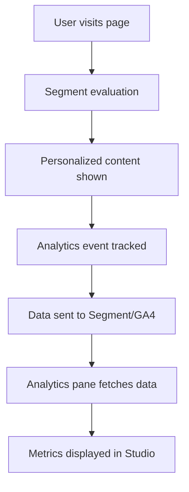

# Personalization Analytics Integration Guide

This guide explains how to integrate real analytics data into the personalization analytics pane within Sanity Studio.

## Overview

The analytics pane is implemented as a **document view** that appears as an additional tab when editing pages or home pages in Sanity Studio. It shows personalization experiment results specific to the current document being edited.

## Features

### Current Implementation (Mock Data)
- ✅ Document-specific analytics view
- ✅ Experiment metrics by segment
- ✅ Time range filtering (7d, 30d, 90d)
- ✅ Performance indicators and insights
- ✅ Winner identification with statistical confidence
- ✅ Revenue and conversion tracking

### Ready for Integration
- 🔧 Segment.io event tracking
- 🔧 Google Analytics 4 integration
- 🔧 Custom analytics endpoints
- 🔧 Real-time data updates

## How It Works

### Document Context
The analytics pane receives the current document being edited:
```typescript
interface AnalyticsPaneProps {
  document: {
    _id: string;        // Sanity document ID
    _type: string;      // Document type (page, homePage)
    title?: string;     // Page title
    slug?: { current: string }; // URL slug
  };
}
```

### Mock Data Structure
```typescript
interface ExperimentMetrics {
  segmentId: string;          // Audience segment ID
  segmentName: string;        // Human-readable segment name
  componentType: string;      // Component being tested (Hero, CTA, etc.)
  impressions: number;        // Page views
  clicks: number;            // Button/link clicks
  conversions: number;       // Goal completions
  conversionRate: number;    // Conversion percentage
  clickThroughRate: number;  // CTR percentage
  averageTimeOnPage: number; // Seconds
  bounceRate: number;        // Bounce percentage
  revenue: number;           // Revenue generated
  confidence: number;        // Statistical confidence
  isWinner: boolean;         // A/B test winner
}
```

## Integration with Real Analytics

### 1. Segment.io Integration

Replace the mock data generator with real Segment API calls:

```typescript
import { SegmentIntegration } from '../utils/analytics-integration';

const segment = new SegmentIntegration({
  writeKey: process.env.SANITY_STUDIO_SEGMENT_WRITE_KEY!
});

// Fetch experiment metrics for the current page
const metrics = await segment.getExperimentMetrics(
  document._id, 
  timeRange
);
```

**Required Setup:**
1. Add Segment write key to environment variables
2. Configure custom dimensions for segment tracking
3. Set up goal tracking for conversions

### 2. Google Analytics 4 Integration

```typescript
import { GoogleAnalyticsIntegration } from '../utils/analytics-integration';

const ga4 = new GoogleAnalyticsIntegration({
  measurementId: process.env.SANITY_STUDIO_GA4_MEASUREMENT_ID!,
  apiSecret: process.env.SANITY_STUDIO_GA4_API_SECRET!
});

// Fetch page-specific metrics
const metrics = await ga4.getExperimentMetrics(
  document.slug?.current || '/',
  timeRange
);
```

**Required Setup:**
1. Configure GA4 custom dimensions
2. Set up conversion goals
3. Enable GA4 Reporting API
4. Implement OAuth2 authentication

### 3. Event Tracking

Track personalization events on the frontend:

```typescript
// When a component is displayed
analytics.trackEvent({
  userId: getUserId(),
  segmentId: 'mobile-users',
  componentType: 'hero',
  eventType: 'impression',
  timestamp: new Date(),
  metadata: { 
    page: window.location.pathname,
    documentId: 'page-123'
  }
});

// When user interacts with personalized content
analytics.trackEvent({
  userId: getUserId(),
  segmentId: 'mobile-users', 
  componentType: 'hero',
  eventType: 'click',
  timestamp: new Date(),
  metadata: { buttonText: 'Get Started' }
});
```

## Customization

### Adding New Document Types

To show analytics for additional document types:

```typescript
// In sanity.config.ts
views: (prev: any[], { schemaType }: { schemaType: string }) => {
  if (['page', 'homePage', 'blog', 'product'].includes(schemaType)) {
    return [...prev, analyticsViewConfig];
  }
  return prev;
}
```

### Custom Metrics

Add new metrics to the analytics interface:

```typescript
interface ExperimentMetrics {
  // Existing metrics...
  
  // Custom metrics
  emailSignups: number;
  downloadCount: number;
  shareCount: number;
  timeToConversion: number;
}
```

### Different Analytics Providers

Create new integration classes:

```typescript
// Mixpanel integration
export class MixpanelIntegration {
  async getExperimentMetrics(documentId: string, timeRange: string) {
    // Implement Mixpanel API calls
  }
}

// Custom analytics
export class CustomAnalyticsIntegration {
  async getExperimentMetrics(documentId: string, timeRange: string) {
    // Implement custom API calls
  }
}
```

## Environment Variables

Add to your `.env.local`:

```bash
# Segment.io
SANITY_STUDIO_SEGMENT_WRITE_KEY=your_segment_write_key

# Google Analytics 4
SANITY_STUDIO_GA4_MEASUREMENT_ID=G-XXXXXXXXXX
SANITY_STUDIO_GA4_API_SECRET=your_api_secret

# Custom Analytics
SANITY_STUDIO_ANALYTICS_API_URL=https://your-analytics-api.com
SANITY_STUDIO_ANALYTICS_API_KEY=your_api_key
```

## Usage in Studio

1. **Open any page or home page** in Sanity Studio
2. **Look for the "Analytics" tab** next to "Content"
3. **View experiment results** specific to that page
4. **Filter by time range** using the buttons
5. **Identify winning variants** with confidence levels
6. **Review performance insights** and recommendations

## Data Flow



## Next Steps

1. **Replace mock data** with real analytics integration
2. **Set up event tracking** on the frontend
3. **Configure analytics goals** in your chosen platform
4. **Test data flow** end-to-end
5. **Add custom metrics** specific to your business needs

The analytics pane provides a powerful way for content editors to see the real impact of their personalization efforts directly within the editing interface, enabling data-driven content decisions. 